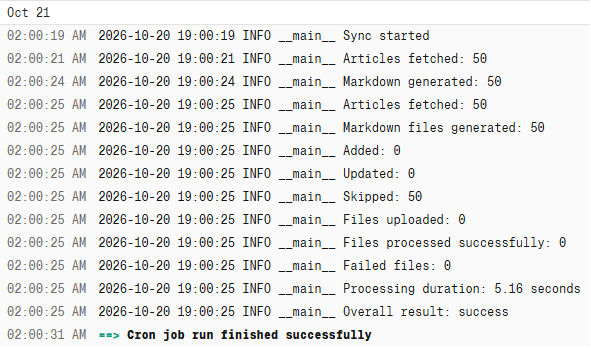
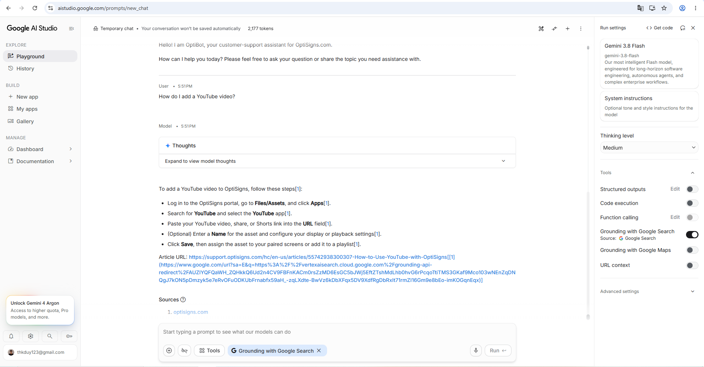

# OptiBot knowledge sync

This job syncs public Zendesk Help Center articles to a Gemini File Search Store. It creates deterministic Markdown files, uploads new or changed articles, waits for indexing, and removes superseded documents.

## Setup

Requirements: Python 3.12+ and a Gemini API key. Install dependencies, copy `.env.sample` to `.env`, and set `GEMINI_API_KEY`. Run `python create_store.py`, then put its returned store name in `GEMINI_FILE_SEARCH_STORE`. The default state backend also requires a GitHub token with Gist read/write access and a Gist ID you control (`GITHUB_TOKEN`, `GITHUB_GIST_ID`). Alternatively, set `STATE_BACKEND=local` to keep state in local JSON files.

## Run locally

```powershell
python -m pip install -r requirements.txt
Copy-Item .env.sample .env
# Set GEMINI_API_KEY in .env
python create_store.py
# Set GEMINI_FILE_SEARCH_STORE and the required state-backend values in .env
python main.py
```

The job runs once: exit code `0` means success; `1` means failure. Unit tests can be run with `pytest -q`. To run in Docker, build with `docker build -t knowledge-sync .`, then run `docker run --rm --env-file .env knowledge-sync`.

## Daily job logs

The job runs daily on [Render](https://dashboard.render.com/). View the [scheduled job logs](https://dashboard.render.com/cron/crn-dbbk3tuq1p3s73cslcd0/logs?r=live) in the Render dashboard (sign-in required). For a quick view of the latest run summary, open [`last-run.json` on GitHub Gist](https://gist.github.com/thkduy/ed980e349bd9ce26a3602fbf370949fc#file-last-run-json); it includes the latest sync counts and status.



## Chunking strategy

Each support article is saved as a separate Markdown file and uploaded to Google Gemini File Search API. Gemini manages the actual chunking and embedding process internally.

The initial configuration uses whitespace-based chunking with a maximum of 200 tokens per chunk and 20 tokens of overlap. These values provide a baseline for testing retrieval quality and can be adjusted if needed.

The pipeline logs sync summary counts and article synchronization failures. Exact chunk counts are not reported because the documented API does not expose a total count of indexed chunks.

## Assistant sample

Ask Gemini File Search: **“How do I add a YouTube video?”** Verify the answer and its `Article URL:` citation against the retrieved article.


